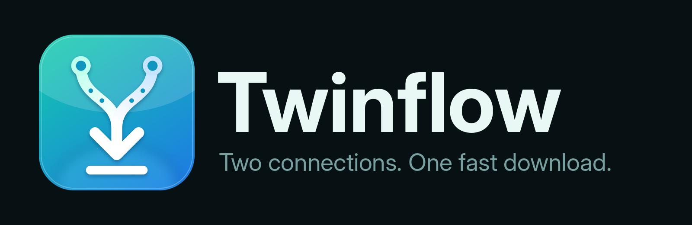

<p align="center">
  
</p>

<h3 align="center">Two connections. One fast download.</h3>

**Twinflow** is a Windows download manager that downloads one file over **two internet connections at the same time**, for example phone USB tethering plus your home Wi-Fi, and joins the pieces into a single file. Your speed is roughly the two links added together.

## Features

- **Two links at once.** Each adapter downloads different pieces of the file using HTTP range requests, and each is forced onto its own network.
- **Pause and resume.** Pause one download or all of them. Stopped or failed downloads resume where they left off.
- **Many links, your way.** Paste several links at once, with an optional sequential mode (one after another).
- **Magnet and torrent links** (through libtorrent).
- **Low memory use.** Pieces are written straight to disk, so even a 90 GB file doesn't fill your RAM.
- **Live stats.** Speed graph per adapter, plus peak speed, average speed, and downloading/idle timers for each download.
- **Personalisation.** Dark, Light, Midnight and AMOLED themes, accent colours and a custom colour picker.
- **Diagnostics.** A built-in test shows what each adapter can reach.

## Download

Get **Twinflow.exe** from the [Releases page](../../releases). No install needed, just run it.

> Windows may warn that the app is unsigned. Click **More info**, then **Run anyway**.

## Run from source

Needs Python 3.12 on Windows.

```
py -3.12 dualdl.py
```

For torrent support, install libtorrent first: `py -3.12 -m pip install libtorrent`

## Build the exe yourself

```
py -3.12 -m pip install --upgrade pyinstaller psutil libtorrent
py -3.12 -m PyInstaller --onefile --noconsole --name Twinflow --icon twinflow.ico --clean --collect-all libtorrent dualdl.py
```

The result is `dist\Twinflow.exe`.

## How to get the full speed

1. Connect both links first: for example phone tethering over USB (shows up as Ethernet) and Wi-Fi.
2. Click **New download**, paste the link, and pick the adapters to use.
3. Use more connections per adapter (16 is the default) if a host limits each connection.

Command-line test for one link: `py -3.12 dualdl.py --diag "LINK" ADAPTER_IP_1 ADAPTER_IP_2` (use each adapter's local address from `ipconfig`, not your public IP).

## Limits

- The server must allow **range requests**. If it doesn't, only one connection is used and the app tells you.
- It can't get around a host's own limits, such as a Google Drive download quota or a blocked IP.
- Both connections need real bandwidth of their own for the speeds to add up.
- It speeds up **one file at a time**. It doesn't merge your internet for games or streaming. That needs a bonding service.
- It does not download from Steam, Netflix, or other services with their own delivery apps.
- Torrent support has not been tested widely.
- Windows only.

## Settings

Settings are kept in `%APPDATA%\Twinflow\settings.json`.

## Licence

MIT
